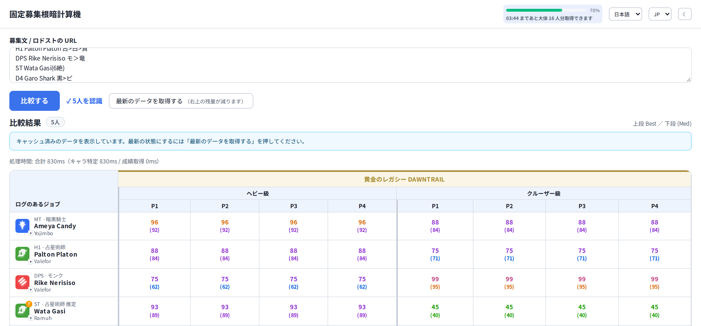
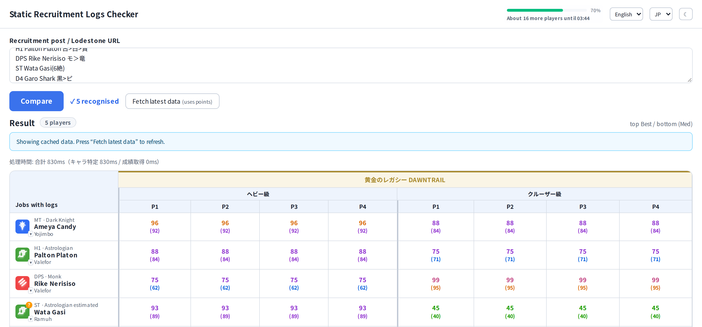
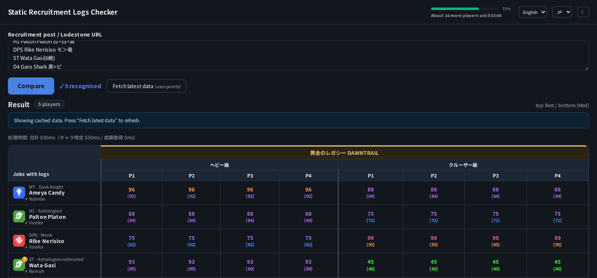

# 固定募集スカウター / Static Recruitment Logs Checker

FF14 の固定募集文を貼り付けると、募集枠（MT / ST / H1 / H2 / D1〜D4）から最大 8 人を抽出し、
直近 6 つの零式の FFLogs 成績を横並びで比較する Web アプリ。

固定の募集で「この人の実績はどうか」を素早く見るために作った。



<details>
<summary>English UI / ダークモード</summary>





</details>

## できること

* **募集文をそのまま貼るだけ**。フォーマットは決まっておらず、行の形から募集枠を推定する
  （`MT：Ameya Candy 暗＞ナ（7絶）` `・D1orD2　竜orヴ：Vega XIII` など）
* **Lodestone の URL** を貼れば本文を自動取得してから解析する
* キャラクター名から World を特定する（World 表記が無くても Lodestone と FFLogs を突き合わせる）
* 直近 6 零式 × 4 層の **Best Perf. / Median Perf.** を 1 画面で比較
* 数値は FFLogs の parse color で色分け。拡張ごとにヘッダを色分け
* ジョブが書かれていなければ**その人のメインジョブ**を推定して表示
* セルをクリックすると Kills / Best Amount / Fastest Kill / Active を表示
* キャラクター名から FFLogs の該当ページへ飛べる
* **日本語 / English の UI 切り替え**（右上）
* **リージョン指定**（JP / NA / EU。右上。Lodestone の検索がリージョン別のため）
* ダークモード

## セットアップ

```bash
npm install
cp .env.example .env      # FFL_CLIENT_ID / FFL_CLIENT_SECRET を設定
npm run fetch:icons       # ジョブアイコンを取得（後述）
npm run dev               # http://localhost:3000
```

### ジョブアイコンについて

アイコン画像は FF14 の**ゲーム内アセット**なので、このリポジトリには含めていない。
`npm run fetch:icons` で XIVAPI（`https://xivapi.com/i/062000/0620XX_hr1.png`）から取得して
`public/jobs/` に保存する。取得するまでは 3 文字略称（`AST` `DRK` など）で表示される。

FFLogs のクライアント資格情報は <https://www.fflogs.com/api/clients/> で発行する
（`client_credentials` グラント。リダイレクト URL はダミーでよい）。

`.env` は `.gitignore` 済み。**リポジトリに資格情報を含めないこと。**

```bash
npm test        # node:test（162 件）
npm run build   # 本番ビルド
```

## 制限

* **UI は日本語 / English の 2 言語。** 右上で切り替える（既定は日本語）
* **英語のジョブ名は解析できない。** 英略称（`GNB` `WHM` `SAM`）は認識するが、
  英語の正式名（`Gunbreaker` `White Mage`）は未対応。日本語の略称・俗称が主軸
* 募集文の解析は日本語圏の固定募集の書き方を前提にしている（`＞` `or` `絶` など）
* **リージョンは右上で指定する**（既定 JP）。Lodestone の検索がリージョン別で
  返るワールドが違うため（実測: `jp.` は Elemental/Gaia/Meteor/Mana のみ、`na.` は
  Aether/Primal/Crystal/Dynamis のみ、`eu.` は Chaos/Light のみ）。
  NA / EU の募集を扱うときは切り替える
* ジョブアイコンは同梱していない（`npm run fetch:icons`）
* レート制限は FFLogs の **720 points/時間**。詳細は「API points が最大の制約」を参照
* 仕様と実装の変遷: [`1st.md`](./1st.md)
* FFLogs API の実測結果: [`docs/API-FINDINGS.md`](./docs/API-FINDINGS.md)

## ライセンス

MIT（[`LICENSE`](./LICENSE)）。

FF14 のゲーム内アセット（ジョブアイコン）は**同梱していません**。
`npm run fetch:icons` は XIVAPI から取得するだけで、リポジトリには含めない方針です。
FF14 および関連する名称・画像は株式会社スクウェア・エニックスの著作物です。

## 構成

| 領域 | 採用技術 |
| --- | --- |
| フロント / サーバ | Next.js (App Router) + TypeScript |
| スタイル | Tailwind CSS v4（`@theme` にトークンを集約） |
| UI 部品 | Radix UI（Popover）+ clsx / tailwind-merge（shadcn/ui と同じ土台） |
| フォント | Noto Sans JP（next/font/google） |
| ホスティング | Vercel 想定 |
| キャッシュ | Upstash Redis（未設定時はプロセス内メモリにフォールバック） |
| データ源 | FFLogs v2 GraphQL API |

PostgreSQL は使わない。FFLogs から再取得可能なデータだけを Redis に長期間キャッシュする。

## セットアップ

```bash
npm install
cp .env.example .env      # FFL_CLIENT_ID / FFL_CLIENT_SECRET を設定
npm run fetch:icons       # ジョブアイコンを取得（後述）
npm run dev               # http://localhost:3000
```

### ジョブアイコンについて

アイコン画像は FF14 の**ゲーム内アセット**なので、このリポジトリには含めていない。
`npm run fetch:icons` で XIVAPI（`https://xivapi.com/i/062000/0620XX_hr1.png`）から取得して
`public/jobs/` に保存する。取得するまでは 3 文字略称（`AST` `DRK` など）で表示される。

`.env`:

```dotenv
FFL_CLIENT_ID=...
FFL_CLIENT_SECRET=...

# 任意（未設定ならプロセス内メモリ。Vercel では設定必須）
UPSTASH_REDIS_REST_URL=
UPSTASH_REDIS_REST_TOKEN=
```

## コマンド

```bash
npm run dev            # 開発サーバ
npm run build          # 本番ビルド
npm run typecheck      # tsc --noEmit
npm test               # node:test（純関数のユニットテスト）

npm run fetch:icons    # public/jobs/*.png を XIVAPI から取得
npm run fetch:worlds   # 全ワールド一覧を worlds.generated.ts に生成
npm run fetch:world-dc # ワールド → データセンターを world-dc.generated.ts に生成
npm run fetch:tiers    # 対象 Tier の解決結果を確認
npm run measure:points # API points の実測

# 追加の確認用スクリプト（要: npm run dev などでアプリを起動）
node scripts/e2e-check.mts http://127.0.0.1:3000   # 実データでの通し確認（points を消費）
node scripts/screenshot.mts out.png                # API をスタブして UI を撮影（points 消費なし）
```

## 設計上の要点

### 遅延の内訳（実測）

| ケース | 所要時間 |
| --- | --- |
| キャッシュ済みの compare（8 人 × 6 Tier） | **約 2〜6ms** |
| キャッシュが空の compare | 約 1.2 秒（うち Lodestone 検索 約 0.96 秒 / FFLogs 2 往復 約 0.4 秒） |
| 改善前（逐次実行） | 約 4.0 秒 |

遅さの正体は FFLogs ではなく **Lodestone 検索（1 件 0.7〜0.9 秒）** だった。
対策として、キャラクター特定は alias で 1 リクエストにまとめ、
Lodestone 検索は FFLogs のバッチと並行に走らせている（`resolveSlots`）。

**開発サーバを再起動するとメモリキャッシュが消えるため、次の 1 回だけ必ず遅くなる。**
Upstash Redis を設定すればキャッシュが永続するので、この待ちは初回のみになる。

### API points が最大の制約

FFLogs の points 上限は **720 / 時間**で、消費量は「返ってくるランキングの数」に比例する
（HTTP リクエスト数ではない）。8 人 × 6 Tier の初回取得で大きな割合を消費するため、

* 通常のページ表示では FFLogs を叩かず、キャッシュだけを表示する
* 「最新データを確認」ボタンを押したときだけ問い合わせる
* 同一対象の同時更新は Redis の `SET NX EX` による refresh lock で 1 本に制限する
* キャッシュ TTL ではなく「問い合わせ頻度」で制御する

という方針を取っている（`src/lib/fflogs/repository.ts`, `src/lib/cache/`）。

### 入力の扱い

* **募集文の名前のあたりを貼る。** 全文でなくてよい。フォーマットは決まっておらず、行の形から募集枠を推定する。
* **Lodestone の URL を 1 つだけ貼る**と、本文を自動取得してから解析する。
  取得先は FF14 公式ドメインに限定（`URL_FETCH_ALLOWED_HOSTS` でカンマ区切り追加）。
* クリア済コンテンツ（`絶テマ/アレキ/エデン(学)済`）・回数（`2絶`）・注記（`※固定主`）は無視する。
* `募集中` `対応中` の行はキャラクターとして扱わない。
* 日本語略称・俗称（`ガ` `鎌` `リ` `筆` `ピ` `ヴ` など）と英略称の両方を受け付ける。
  英略称は**大文字のみ**（キャラクター名 `Sam Fisher` を `SAM` と誤認しないため）。
* 1 文字略称は全文検索せず、**ポジション表記の隣・行頭・キャラクター名と対になっている**
  といった募集枠らしい構造の中でのみ採用する。

### 比較表の見方

* 上段が **Best Perf.**、下段が括弧付きで **Median Perf.**（例 `(95)`）。
* 数字の色は FFLogs の parse color（「色の定義場所」を参照）。
* セルをクリックすると右下に詳細が出る（Kills / Best Amount / Fastest Kill / Active）。

### ジョブ判定

* internal な `JobId`（`gunbreaker` など）に正規化し、FFLogs へは `specName`（`Gunbreaker`）を渡す。
* 日本語略称・俗称を主軸にした alias 辞書（`src/lib/jobs/aliases.ts`）。
* `赤` `学` `賢` などの 1 文字略称は**募集枠らしい構造の中でのみ**採用する（`src/lib/jobs/match.ts`）。
* `モ＞竜` `竜orヴ` のような**着替え可の連鎖**は先頭を募集ジョブとして扱う。

### ログと API 消費の記録

1 行 1 JSON で stdout に出す（Vercel のログでもそのまま検索できる）。

```bash
LOG_LEVEL=debug npm run dev      # debug|info|warn|error|silent（既定: 開発=debug / 本番=info）
LOG_FORMAT=pretty npm run dev    # 人間が読みやすい 1 行形式
```

記録しているもの:

| イベント | 内容 |
| --- | --- |
| `request.start` / `request.done` | API ごとの所要時間・結果・スロット数 |
| `fflogs.request.start` / `fflogs.usage` | operation 名・所要時間・**消費 points**・pointsSpentThisHour |
| `character.batch_lookup` | まとめ取得の要求件数とヒット数 |
| `lodestone.search` / `lodestone.cache_hit` | Lodestone 検索の候補数と所要時間 |
| `tiers.cache_hit` / `tiers.fetched` | zone カタログのキャッシュ状況 |
| `rankings.loaded` | 取得 Tier 数・鮮度でスキップした数 |
| `compare.done` | キャラ特定 / 成績取得 / 合計の内訳 |

秘匿情報（client secret / token / Authorization）は `redact()` で必ず落とす。

**API 消費の確認:**

```bash
curl -s localhost:3000/api/status | jq '.usage'
# {
#   "today":   { "requestsTotal": 12, "pointsObserved": 214, "requests": { "ZoneRankingsBatch": 2, ... } },
#   "recent":  { "days": 7, "requestsTotal": 96, "pointsObserved": 1680 },
#   "current": { "pointsSpentThisHour": 202, "limitPerHour": 720, "remaining": 518 }
# }
```

日次で `fflogs:usage:YYYY-MM-DD` に記録し、90 日保持する。
`pointsSpentThisHour` は 1 リクエスト分遅れて反映されるため `pointsObserved` は目安
（`requests` は正確）。UI のツールバーにも今週の消費が出る。

各 API レスポンスには `Server-Timing` ヘッダが付くので、ブラウザの DevTools の
Network → Timing でサーバ側の内訳（resolve / rankings / total）が見える。

### キャッシュに入れているもの（= いわゆる DB 側）

「毎回取りに行く」を無くすため、**ネットワーク結果はすべて Redis に保存**している。
2 回目以降は 1 往復も発生しない。

| キー | 内容 | TTL | 元 |
| --- | --- | --- | --- |
| `fflogs:lookup:{region}:{slug}:{name}` | **名前 + World → canonicalID** | 180日 | FFLogs |
| `fflogs:lodestoneid:{id}` | Lodestone ID → canonicalID | 180日 | FFLogs |
| `fflogs:charid:{id}` | FFLogs ID → キャラクター | 180日 | FFLogs |
| `fflogs:nameindex:{name}` | **名前 → 確定済み候補一覧**（World 無しの枠用） | 180日 | Lodestone + FFLogs |
| `fflogs:lodestone:{name}` | 名前 → Lodestone 生候補 | 30日 | Lodestone |
| `fflogs:character:{canonicalID}` | 成績ドキュメント（ジョブ × Tier × 層） | 180日 | FFLogs |
| `fflogs:tiers` | 対象 Tier カタログ | 7日 | FFLogs |
| `fflogs:worlds` | ワールド一覧（既定は静的生成を使用） | 7日 | FFLogs |
| `fflogs:usage:{YYYY-MM-DD}` | API 消費実績 | 90日 | 自前 |
| `fflogs:refresh:{scope}` | refresh lock（NX + EX） | 60秒 | 自前 |

**`fflogs:nameindex` が要点。** World 表記が無い枠は、一度解決した名前をここに確定済み候補として保存する。
次回は Lodestone も FFLogs も呼ばずに解決でき、**Lodestone が落ちていても既知の名前は引ける**。

TTL は長めに取っている。仕様 §26 のとおり「TTL で更新を制御する」のではなく、
FFLogs への問い合わせ頻度を `DATA_MAX_AGE_DAYS`（既定 7 日）で制御するのが主旨。

### キャッシュの保存先

| 条件 | 使うストア | 再起動で消える？ |
| --- | --- | --- |
| `UPSTASH_REDIS_REST_URL` / `_TOKEN` あり | Upstash Redis | 消えない |
| 上記なし（開発） | **`.cache/store.json` にファイル永続** | **消えない** |
| Vercel かつ Upstash なし | プロセス内メモリ | 消える（コールドスタートごとに再取得） |
| `CACHE_PERSIST=0` | プロセス内メモリ | 消える |

```dotenv
CACHE_FILE=.cache/store.json   # 保存先を変えたい場合
CACHE_PERSIST=0                # ファイル永続を無効化（メモリのみ）
```

メモリストアだと `npm run dev` を再起動するたびにキャッシュが消え、
毎回 1 秒以上かかる cold path を踏んでしまうため、開発ではファイルへ書き出している。
Vercel では `/tmp` 以外が読み取り専用なので既定でメモリを使う（Upstash 推奨）。

### キャッシュの鮮度（API points 節約）

「最新データを確認」を押しても、**最終取得から `DATA_MAX_AGE_DAYS`（既定 7 日）以内の Tier は再取得しません**。
7 日より古い Tier だけを取り直します。何度押しても points は増えません。

```dotenv
DATA_MAX_AGE_DAYS=7        # 0 にすると常に取り直す
```

リクエスト単位で鮮度チェックを無視したい場合（検証用）は `/api/refresh` に `ignoreFreshness: true` を渡します。

### 候補が複数あるときの扱い

World 表記が無く候補が複数ある場合でも、**DC 優先の先頭を「推定」として自動採用**して解決する。
未選択のままにすると「DC を優先しているのに何も表示されない」状態になって分かりにくいため。

* 推定状態はチップに「**推定**」と破線で示す（確定状態と区別する。仕様 §8）
* チップを押せばいつでも選び直せる。選び直すと「推定」は消える
* 推定採用した行は成績の取得が発生する（ジョブが判明している場合のみ。1 行 ≒ 30 points）

### World 候補の並び順

World 表記が無い枠は候補が複数出る。**同じ DC の候補を先頭**に並べる。
DC の手掛かりが無い場合は「候補が 1 件に絞れた枠」を先に解決し、そこで判明した DC を多数派として使う。

```
MT：Ameya Candy 暗＞ナ（7絶）   -> Ameya Candy @ Yojimbo [Meteor]   （一意に確定）
DPS：Rike Nerisiso モ＞竜       -> Rike Nerisiso @ Valefor [Meteor] （一意に確定）
ST： Wata Gasi(6絶 ...)         -> 候補が複数 -> Meteor を先頭に並べる
```

画面上部の **DC 優先** セレクタで上書きでき、選んだ DC は localStorage に記憶する。
募集文に World が 1 つも無い場合、システム側だけでは DC を断定できないため、
最終的な判断はユーザーに委ねる設計にしている。

### World 表記が無い募集文への対応

FFLogs は **キャラクター名だけでは特定できない**（`name` + `serverRegion` でも `null` が返ることを実測で確認）。
募集文に World が書かれていないケースが多いため、次の順で解決する。

1. 募集文に Lodestone のキャラクター URL があれば `lodestoneID` で FFLogs を直接引く
2. World の記載があれば名前 + World + Region で引く（同名ワールドが複数リージョンにある場合は JP を優先し、失敗したら次を試す）
3. どちらも無ければ **Lodestone のキャラクター検索**で名前から World を解決し、候補ごとに FFLogs を引く
   * 1 件に絞れたら自動採用
   * 複数見つかったら World / DC を並べて選ばせる（`Chocobo` が JP と KR にあるなど、同名ワールドの衝突もここで解消）
   * 固定は同じ DC で組まれることがほとんどなので、**判明しているメンバーの多数派 DC を先頭に寄せる**
     （World → DC は `npm run fetch:world-dc` で Lodestone から生成）

メンバーの解決は 2 パスで行う。1 パス目で World か Lodestone URL がある枠（＝DC の手掛かりになる枠）を解決し、
2 パス目で World 無しの枠を多数派 DC を優先して並べる。

### 表示

* ジョブアイコンは **ロール色（タンク青 / ヒーラー緑 / DPS 赤）の角丸四角 + 白抜き**
* 表のヘッダは**拡張ロゴの色**で塗り分け（暁月＝クリーム / 漆黒＝青灰 など）
* Perf の数値色は FFLogs の parse color。**ライトモードだけ緑を暗くしている**
  （FFLogs 標準の `#1eff00` は白背景でコントラストが足りないため。ダークモードは標準値）
* 比較表の下段は FFLogs の Median Perf. を表示（`Med` と略記）
* **ダークモード対応**（ヘッダ右上のトグル。`prefers-color-scheme` を初期値にして localStorage に記憶）
* 拡張ヘッダとロール色は、参考デザインのスクリーンショットからピクセルを実測して合わせた

### レート制限の表示

ヘッダ右上に残量を出す（`src/components/RateLimitBadge.tsx`）。

```
[█████░░░░░░░░░░░░░░░░░░░░░░] 22%
14:14 まであと大体 5 人分取得できます
```

* **「人分」で数える。** このツールは 1 人について常に 6 零式ぶんをまとめて取る（処理で固定）ので、
  実測 5 points/零式 × 6 = **1 人 ≒ 30 points**。「あと何人ぶん取れるか」が実用的な単位になる
* 30 points に満たないときは「1 人分に足りません（HH:MM まで）」
* 表示は**この 2 行だけ**。points や零式の内訳はユーザーの判断に使わないので出さない
  （単価や遅延の注意はツールチップに退避）
* **消費した直後は残量を取り直す**（`/api/status?fresh=1`）。
  `pointsSpentThisHour` は「そのリクエストの直前」の値なので、そのまま読むと
  **最後のリクエストぶんが抜けて残量が実際より多く見える**（実際これで 429 を踏んだ）。
  `fresh=1` のときだけサーバーが `rateLimitData` を読み直す（1 point）。ページ表示時は読まない
* 値が変わるとバーが 0.7 秒でアニメーションし、枠が一瞬光る
* 「Tier」という語は UI に出さない（「零式」と言い換える）
* 残量 50% 超は緑、20% 超は琥珀、それ以下は赤
* `pointsSpentThisHour` は FFLogs 側の反映が 1 リクエスト遅れるため、ツールチップにその旨を書いている
* 観測時刻からの経過を自前で数え、**回復時刻を過ぎたら消費 0 とみなす**（サーバーに問い合わせ直さない）

#### 回復は「固定ウィンドウの一括リセット」（実測）

5 分おきに 17 回サンプリングして境界をまたいだ結果:

| 経過 | pointsSpentThisHour | pointsResetIn |
| --- | --- | --- |
| t=0s | 3 | 3432 |
| t=3003s | 13 | 430 |
| t=3303s | 14 | 129 |
| **t=3603s** | **1** | **3600** |
| t=3904s | 2 | 3300 |

* サンプル間の増分は**毎回ちょうど +1**（＝自分が投げた計測クエリ 1 点ぶん）。
  **時間経過で points が減ることは無い**（ローリングではない）
* `resetIn` が 0 になった瞬間に **14 → 1 へ一括で落ちる**（1 はそのサンプル自身の消費）
* したがって「`resetIn` まで 0 回復 → 0 で全回復」という**ステップ関数**が実挙動と一致する。
  線形に徐々に回復する実装は誤り
* 比較・ジョブ探索・Active 取得のあとに `/api/status` を取り直して更新する

### Active（アクティブ率）

FFLogs の `character` 系エンドポイントに Active は無く、**Report の DamageDone テーブル**にしかない。
`report code` と `fightID` が必要なので 2 段階になる。

1. `encounterRankings` から Best Perf の fight を特定（report code / fightID）
2. `report.table(dataType: DamageDone)` を引く

**計算**: `activeTime` はミリ秒なので `activeTime / totalTime × 100`。
実測例: 507225ms / 508871ms = **99.68%**。

セルを開いたときだけ取得する（全セルぶん先に取ると 8 人 × 6 零式 × 4 層 = 192 fight ぶんになり、
2 リクエスト/セルで数百 points かかるため）。

### 画面に出す情報の線引き

内部の実装詳細はユーザーには出さない。

判断基準と禁止例は **`AGENTS.md`** にまとめてある（AI エージェント向けの指示）。

| 出さない | 代わりに |
| --- | --- |
| キャッシュの種類（`file` / `upstash` / `memory`） | 出さない（`/api/status` には残す） |
| `pointsSpentThisHour` などの生の points | 「あと N 人分取得できます」 |
| `Tier` | 「零式」 |
| 「〜を優先」 | 「メンバーから 〜 と推測」（設定に見えるため） |
| 「切り替えると 1 人分かかります」 | 主語を補って「**World を**切り替えると 1 人分かかります」 |
| 「最新データを確認」（押し放題に見える） | 「**最新のデータを取得する**（右上の残量が減ります）」 |

### 消費量の文言は単位を揃える

数値は `src/lib/fflogs/costs.ts` に集約する（画面ごとにずれないように）。

* **1 回 = 1 零式 × 1 ジョブ ≒ 5 points**（実測）
* **1 人 = 6 零式ぶん（処理で固定）= 6 回分 ≒ 30 points**

| 画面 | 文言 |
| --- | --- |
| 右上 | `16:22 まであと大体 3 人分取得できます` |
| World 切り替え | `⚠ World を切り替えると 6 回分のポイントを使います` |
| 全ジョブ探索 | `⚠ 全ジョブを調べると 19 回分のポイントを使います` |

「人分」は**残量**（あと何人が取れるか）、「回分」は**操作のコスト**を表す。
| 「7 日以内の N 件は再取得していません」 | 出さない（鮮度管理は内部の話） |
| 反映遅れ・遅延の注意書き | 出さない（`docs/` に書く） |

> その文言は、ユーザーが**次に何をするかを決める**のに必要か？ 必要でなければ消す。

### セル詳細パネル

セルをクリックすると右下に詳細が出る。

* **別のセルをクリックすると直接切り替わる。** 全画面のバックドロップを置くと
  1 回目のクリックを吸って「一度閉じてからでないと開けない」状態になるため、置いていない
* 閉じるのは **× ボタン** / **Esc** / **パネルの外を触る**（`mousedown` を監視するだけでクリックは吸わない）
* **詳細が開いていてもジョブ切替は使える**（開くと詳細は閉じる）。全画面バックドロップは使わない
* 実装用語（`DamageDone テーブル` など）は画面に出さない（`AGENTS.md`）

### キャラクター名から FFLogs へ

比較表のキャラクター名は FFLogs の該当ページへのリンク（別タブで開く）。

```
https://www.fflogs.com/character/{region}/{realm}/{name}
例: https://www.fflogs.com/character/jp/ramuh/Wata%20Gasi
```

* 形式は実在のリンクで確認済み（`fflogs.com/character/NA/Midgardsormr/Leonardo%20Yuneli` など）
* region は `jp` / `na` / `eu` / `oc` / `kr`（`DATA_CENTER_REGION` を小文字化）
* realm は FFLogs が返す `worldSlug` を優先し、無ければワールド名
* region / world が分からない行は**リンクにしない**（推測でリンクを張らない）
* 組み立ては `src/lib/fflogs/links.ts` の `fflogsCharacterUrl`（テスト済み）

### レイアウトが動かない工夫

* 行頭の幅は `232px` 固定。ジョブ切替や World 候補の有無で**列幅が変わらない**
* ジョブ切替・World 候補は **Radix の Popover（Portal）** で body 直下に描画する。
  * 表のスクロール領域（`overflow: auto`）で切れない
  * sticky なヘッダ／セルの下に隠れない
  * 行の高さが増えない（＝他要素に影響しない）
* World 候補は**選択後も残る**ので、間違えても押し直せる

### Tier の日本語名

**FFLogs は英語名しか返さない。** `Zone.name` は `Anabaseios` / `AAC Heavyweight` のような英語で、
`Accept-Language` を付けても変わらない（実測）。
そのため日本語名は `src/lib/fflogs/labels.ts` の**手書きテーブル**で持っている。

| zoneID | ヘッダ表示 | 正式名称（ツールチップ） |
| --- | --- | --- |
| 29 / 33 / 38 | 覚醒編 / 共鳴編 / 再生編 | 希望の園エデン零式：〜 |
| 44 / 49 / 54 | 辺獄編 / 煉獄編 / 天獄編 | 万魔殿パンデモニウム零式：〜 |
| 62 / 68 / 73 | ライトヘビー級 / クルーザー級 / ヘビー級 | 至天の座アルカディア零式：〜 |

* 表のヘッダは幅が限られるので短縮名、**正式名称はマウスオーバーのツールチップ**で見せる
* 新しい零式が追加されたら `ZONE_LABELS_JA` / `ZONE_FULL_NAMES_JA` に 1 行足す
* 未知の zone は FFLogs の英語名でフォールバックするので、追加し忘れても表示は壊れない

### 色の定義場所

| 種類 | 場所 |
| --- | --- |
| Perf 色（ライト / ダーク） | `src/app/globals.css` の `--perf-*` |
| ロール色 | `globals.css` の `--color-role-*`（`src/lib/jobs/jobs.ts` の `ROLE_COLORS` と対応） |
| 拡張色 | `globals.css` の `[data-expansion="..."]` の `--exp-*` |

FF14 / FFLogs 固有の意味を持つ色は Tailwind の既定パレットに寄せず、
上記のトークンに集約している（`src/lib/perf.ts` の `PERF_COLOR_CLASS` がクラス名を固定）。

### 他ジョブの探索と切り替え

* 募集文に **`モ＞竜` / `竜orヴ`** のように着替え可のジョブが書かれていれば、それを探索対象にする。
  全 21 ジョブを引かずに済む（21 alias ≒ 105 points → 2〜3 alias ≒ 10〜15 points）。
* **別ジョブのデータが無いと分かっている行には切り替え UI を出さない**（キャレットも消える）。
  ジョブアイコンを押した時に初めて探索し、見つかったジョブだけを候補にする。
* ピッカーには**いま表示しているジョブも出す**（選択中として強調）。除外すると
  「なぜ今のジョブが一覧に無いのか」が分からなくなる。
* ジョブ不明の枠は、まずポジションに合うロールだけを調べ、**見つからなければ残りのジョブも調べる**。
  例: `ST` 募集でも実際のログが白魔道士だけ、ということが普通にあるため。

```
ST： Wata Gasi   -> タンク 4 ジョブを探索 -> 0 件
                 -> 残り 17 ジョブを探索 -> whiteMage, scholar, astrologian, viper
```

### ジョブ不明の枠

募集文にジョブが書かれていない場合、行頭のアイコンは「？」表示になり、クリックでジョブを選べる。

**アイコンの色**は次の順で決める（`src/components/JobIcon.tsx`）。

1. ポジションからロールが決まる → そのロール色（例: ST ならタンクの青）
   D1〜D4 は近接/遠隔/キャスターにまたがるが、3 つとも同じ赤なので赤になる
2. 決まらない → **ログが見つかったジョブの色**を借りる
3. どちらも無い → 灰色

**候補の順番**は `ROLE_SIMILARITY`（`src/lib/jobs/jobs.ts`）に定義した「ロールの近さ」に従う。

| ポジション | 優先順 |
| --- | --- |
| タンク | タンク > **近接** > ヒラ > 遠隔 > キャス |
| 近接 | 近接 > タンク > 遠隔 > キャス > ヒラ |
| 遠隔 | 遠隔 > キャス > ヒラ > 近接 > タンク |
| キャス | キャス > 遠隔 > ヒラ > 近接 > タンク |
| ヒラ | ヒラ > キャス > 遠隔 > タンク > 近接 |
| D1〜D4 | DPS 3 ロール（近接 > 遠隔 > キャス）> タンク > ヒラ |

考え方は「前線・物理どうし（タンク↔近接）が近い」「後衛どうし（遠隔↔キャス）が近い」。
パッチや好みで変えやすいよう 1 か所にまとめている。

最初に出す候補は**ポジションに合うロールだけ**（例: ST なら「ガ暗ナ戦」の順でタンクのみ）。
そこにログが無ければ、上の近さ順で**残りのロールも自動で探す**。

### alias と課金単位

GraphQL の **alias**（`j0: zoneRankings(...)` の `j0:` の部分）が課金の単位。

> **1 alias = 1 ジョブ × 1 Tier**（その Tier の全層 4〜5 encounter がまとめて返る）

実測（Wata Gasi / Ramuh、`zoneRankings(zoneID, specName, difficulty: 101, metric: dps)`）:

| 投げた alias | 返ってきた encounter 数 | 消費 |
| --- | --- | --- |
| 1（Tier 73 のみ） | `[5]` | 5.01 |
| 1（同） | `[5]` | 5.01 |
| 2（Tier 73, 68） | `[5, 4]` | 10.01 |
| 6（6 Tier ぶん） | `[5, 4, 4, 5, 5, 5]` | 30.01 |

* **単価は 5.01 points/alias の定額**（層の数にもデータ量にもよらない）
* したがって「1 ジョブの成績を 6 Tier ぶん取る」= **6 alias = 30 points**
* `character(id:)` の基本参照は桁違いに安い（5 件で 1.00 points）

> **注意**: `rateLimitData.pointsSpentThisHour` は**そのリクエストの直前**の値。
> 素直に読むと 1 リクエストぶん古い値を見ることになる。
> 正しく測るには、測定対象のあとに別の FFLogs クエリを 1 回投げてその応答を読む（settle 法）。
> この README の数値はすべて settle 法で測っている。

### ジョブ不明の枠のコスト（実測・settle 法）

**方針: 全ジョブ探索は初回にやらない。** 安いクエリで「メインジョブ」を出しておき、
本当に必要になったときだけ探索する。

1. `specName` 無しの `zoneRankings` で **encounter ごとの代表ジョブ**を取る
   （World 候補の検証と兼用。候補 3 件で 15.03 points）
2. ポジションに合うロールがあればそれを、無ければそのメインジョブを**初期表示**にする
3. 他のジョブは、ピッカー内の「**他のジョブのログも探す**」を押したときだけ探索する

ST・ジョブ不明の 1 行（Wata Gasi）、キャッシュが空の状態での実測:

| 方式 | 初期表示 | 追加探索（押したとき） | 表示内容 |
| --- | --- | --- | --- |
| 全 21 ジョブを探索してから表示 | 約 151 | – | ヴァイパー（データ 1 セル） |
| ロールの近さ順で打ち切り | 約 96 | – | ヴァイパー（データ 1 セル） |
| **メインジョブを初期表示（現）** | **47.05** | **+51.02** | 占星術師（データ 5 セル）+ `？` |

初期表示の内訳:

| クエリ | alias | points |
| --- | --- | --- |
| `CharacterBatch`（World 候補 5 件の特定） | 5（軽い参照） | 1.00 |
| `HasLogs`（候補 3 件のログ有無とメインジョブ） | 3 | 15.03 |
| `ZoneRankingsBatch`（選んだジョブ × 6 Tier） | 6 | 30.01 |
| **合計** | | **47.05** |

* 探索コスト（51.02）は**ユーザーが他ジョブを見たいと言ったときだけ**払う
* 初期表示はメインジョブなので**実データが多く出る**（5 セル vs 1 セル）
* 探索は**優先度の高いグループから順に引き、見つかった時点で打ち切る**（`jobProbeGroups`）。

### 見つかったジョブの扱い

* **探索は明示操作のときだけ走る。** ピッカーを開いただけでは points を使わない
* 「全ジョブを調べる」は**残量を大きく消費する**ので、琥珀色の警告表示にしている
  （`⚠ 全ジョブを調べると N 回分のポイントを使います`）
* **World 候補（人）を切り替えたら、その行のジョブ情報は捨てる。**
  ジョブはキャラごとに違うので、残すと別人のジョブを表示してしまう。
  対象: `jobOverrides` / `availableJobs` / `scannedJobs` / `fullyScannedRows` / `probeErrors` / 遅延取得した Active

### メインジョブの推定

拡張（大型パッチ）単位で集計し、**新しい零式ほど重く見る（1 つ前は半分）**。
ジョブは零式ごとに変わるのが普通なので、古い零式のキル数だけで決めると実態とずれる。

対象は**現在の拡張に含まれる零式すべて**（例: 黄金のレガシーなら 73 / 68 / 62）。

Wata Gasi の実測:

| 零式 | 重み | 代表ジョブとキル |
| --- | --- | --- |
| 73 ヘビー級（最新） | 4 | 占星 27 / 白 16 |
| 68 クルーザー級 | 2 | 竜 47 |
| 62 ライトヘビー級 | 1 | 忍 36 |

→ 占星 108 / 竜 94 / 白 64 / 忍 36 で **占星術師** がメイン。
重み無しだと竜騎士になる（＝重み付けが効いている）。

集計方法を変えたら `SNAPSHOT_VERSION` を上げる（古いキャッシュを捨てて取り直す）。

### 探索順の決め方（`jobProbeGroups`）

1. **募集ポジションのロール**（ST ならタンク）。ヒーラー枠はピュア / バリアに分ける
   （H1・PH は `whiteMage, astrologian` → `scholar, sage`、H2・BH はその逆。
   固定では 1 人ずつ入れるのが一般的なので、当たれば 2 alias で打ち切れる）
2. **すでにログが分かっているジョブと同じ装備のジョブ**
   （`GEAR_SET`。例: 占星術師のログが分かっていれば、同じ回復装備の学者・賢者）
3. 残りをロールの近さ順（`ROLE_SIMILARITY`）

すでにログが分かっているジョブは調べ直さない。

#### 実測: 装備優先の効果（Wata Gasi / ST、既知 = 占星術師・白魔道士）

| 手順 | 調べたジョブ | 消費 | 見つかった |
| --- | --- | --- | --- |
| ① 近いロールを調べる | タンク 4 → **学者・賢者 2** で打ち切り | **31.02** | **scholar** |
| ② 全ジョブを調べる | 残り 15 | 66.01 | viper |

装備を優先しなければ（旧: タンク → 近接）10 alias = 51.02 points かかり、
しかも**学者を見逃して**ヴァイパーで打ち切っていた。装備優先のほうが**安く、かつ取り漏らしが少ない**。

### 取り漏らしと「全ジョブを調べる」

探索は見つかった時点で打ち切るため、**全 21 ジョブを覆うまで**
「他にログのあるジョブは無い」とは言えない（`isFullyScanned`）。
そこで UI では 2 つのボタンを出し分ける。

| ボタン | 挙動 | 取り漏らし |
| --- | --- | --- |
| 近いロールを調べる | 優先グループから順に、当たった時点で打ち切り | **あり得る** |
| 全ジョブを調べる | 残りを 1 グループにまとめて最後まで走査 | 無し（終わると「全ジョブを確認済み」表示） |

「全ジョブを調べる」のコスト（残りジョブ数 × 約 5 points）はボタンに表示する。
上の例では ①（31.02）+ ②（66.01）= **97.02 points** で全 21 ジョブを確認し、
`astrologian / whiteMage / scholar / viper` を漏れなく列挙できた。
* **探索で返ってきた最新 Tier の成績を捨てずに保存する。**
  探索クエリは成績取得クエリと引数が同じ（`difficulty` / `metric` / `partition` なし）なので、
  返ってきた `zoneRankings` はそのまま使える。探索で見つかったジョブを選び直すと、
  最新 Tier は取得済みとしてスキップされ **1 alias（約 5 points）節約**できる。

  ```
  探索（タンク4 + 近接6）      = 51.02 points
  ヴァイパーを選び直す          = 26.02 points  fetchedTiers=5 skippedFreshTiers=1
                                （節約しなければ 30.01 points / 6 tier）
  ```

  ※ メインジョブの手掛かりに使う `specName` 無しクエリは encounter ごとに代表 1 ジョブしか
  返さないため、**こちらは再利用しない**（そのジョブのデータが欠ける可能性がある）。
* 調べた結果はキャラクター文書に保存するので、**2 回目以降は 0 points**
* `AUTO_RESOLVE_UNKNOWN_JOBS=0` で初期表示の自動決定を止められる（ジョブ不明の行は「？」のまま）

#### なぜ「specName 無しの zoneRankings」でジョブを列挙できないか

`specName` を指定しない `zoneRankings` は**キャラクターのジョブ一覧を返すものではない**。
実データ（Wata Gasi / AAC Heavyweight）では、**encounter ごとに 1 つの spec だけ**が返る。

| encounter | 返ってくる spec | kills |
| --- | --- | --- |
| Vamp Fatale | WhiteMage | 5 |
| Red Hot and Deep Blue | Astrologian | 4 |
| The Tyrant | WhiteMage | 16 |
| Lindwurm | Astrologian | 11 |
| Lindwurm II | Astrologian | 7 |

つまり FFLogs が「その encounter の代表」として選んだ 1 ジョブしか見えない。
このキャラは実際には **ヴァイパーと学者のログも持っている**が、どの encounter でも代表に選ばれなかったため
この応答には一切現れない（`spec` の集合は `{WhiteMage, Astrologian}` で止まる）。

そのため「安い 1 クエリでジョブを列挙する」ことはできず、
**ジョブごとに明示的に問い合わせる**必要がある（＝「他のジョブのログも探す」）。

ただし**メインジョブを知るには十分**なので、
初期表示と「ログが 1 つでもあるか」の判定にはこのクエリを使っている。
（安いのは「1 キャラ 1 alias で済む」からであって、単価自体は 5.01 points/alias）

ログのあるジョブが判明したら、**その中からポジションの近い順**に表示する。

### Lodestone URL の取り込み

入力欄に Lodestone の URL を 1 つだけ貼ると、サーバ側で本文を取得してからパーサに流す。
取得先は FF14 公式ドメインに限定している（SSRF 対策。`URL_FETCH_ALLOWED_HOSTS` で追加可）。

### 募集文パーサ

フォーマットが書き手ごとに毎回変わるため、キーワードで行を捨てず
「キャラクター名らしい英字トークンが取れるか」で最終判定する（`src/lib/parser/parseRecruitment.ts`）。

対応している実例:

```
MT Rion Aster / ガンブレイカー / Chocobo
✒MT：暗 Raye Skystriker：絶テマ/アレキ/エデン(学)済
・D1orD2　竜orヴ：Vega XIII　6絶（最初から）※固定主
MT：Ameya Candy 暗＞ナ（7絶）
ST： Wata Gasi(6絶　ケフカ以外済)
DPS :(メレーorキャス)募集中！      ← キャラクターではないので無視
```

### Best / Avg / Active の出典

| 表示 | FFLogs のフィールド |
| --- | --- |
| Best | `zoneRankings.rankings[].rankPercent` |
| Avg | `zoneRankings.rankings[].medianPercent`（FFLogs 表記は Median Perf.） |
| Kills | `rankings[].totalKills` |
| Active | `report.table(DamageDone).data.entries[].activeTime`（遅延取得） |

キャラクター特定のコストは 1 件あたり約 1 point。ワールド一覧（125 ワールド）は
`npm run fetch:worlds` で静的生成しており、実行時には API を叩かない（実測 31 points の節約）。

FFLogs の `zoneRankings` には層ごとの「平均」フィールドが存在しない（Best / Median の 2 つのみ）。
そのため比較表の下段は FFLogs の Median Perf. をそのまま表示しており、独自の平均計算はしていない。

character 系エンドポイントに Active は存在しないため、セル詳細を開いたときだけ
Report から FFLogs の Active 列を取得する。自前の GCD uptime 計算は行わない。

## ディレクトリ

```
src/
  app/                         ページと API ルート
    api/parse/compare/refresh/cell/status
    page.tsx  help/page.tsx
  components/                  CompareTable / JobIcon
  lib/
    fflogs/                    client, queries, tiers, repository, model
    jobs/                      jobs, aliases, match
    parser/                    parseRecruitment, worlds, worlds.generated, fetchUrl
    lodestone/lodestone.ts     Lodestone のキャラクター検索・ページ取得
    cache/                     store, keys, refreshLock
    api/dto.ts  perf.ts  labels.ts
scripts/                       アイコン取得・Tier 確認・points 実測
tests/                         ユニットテスト
docs/API-FINDINGS.md           FFLogs API の実測メモ
```
